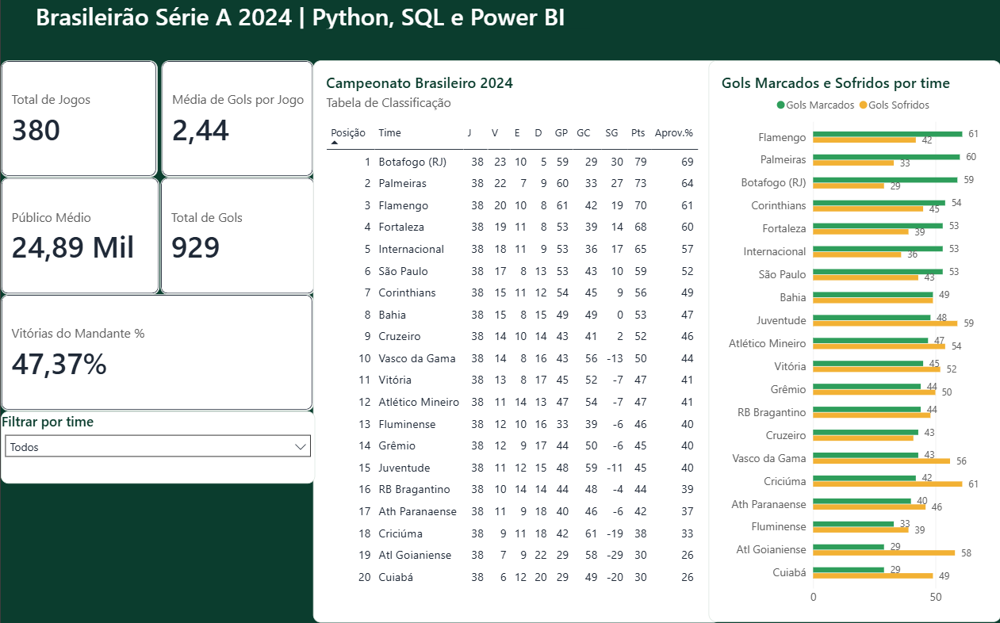
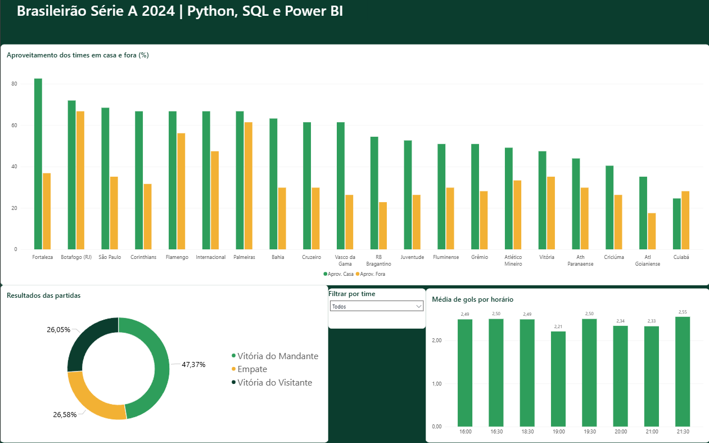
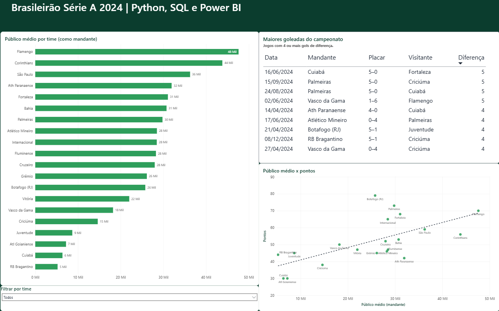

# Análise do Brasileirão Série A 2024

Projeto de análise de dados que percorre o caminho completo, do dado bruto ao dashboard: **Python** para tratamento, **SQL (SQLite)** para as consultas de análise e **Power BI** para a visualização.

## Dashboard

**Visão geral**



**Casa x Fora**



**Público e curiosidades**



O arquivo do dashboard está em `powerbi/dashboard_brasileirao_2024.pbix`. Ele tem 3 páginas, com uma segmentação por time sincronizada entre elas.

## Objetivo

Responder, com os dados das 380 partidas da temporada, perguntas como:

- Existe vantagem real em jogar em casa?
- Como ficou a classificação final e quais times tiveram o melhor ataque e a melhor defesa?
- Quais times rendem mais em casa e quais rendem mais fora?
- Quais clubes levam mais público como mandantes, e isso se traduz em pontos?
- Em que horários saem mais gols? Quais foram as maiores goleadas?

## Fonte dos dados

Dataset [Brasileirão 2024 (Série A)](https://www.kaggle.com/datasets/fabioschirmann/brasileiro-2024-srie-a-dataset), disponível no Kaggle. Cada linha é uma partida, com data, horário, mandante, placar, visitante, público e estádio. Consulte a página do Kaggle para os termos de uso do dataset.

## Ferramentas

| Etapa | Ferramenta |
|---|---|
| Tratamento dos dados | Python (pandas, numpy) |
| Armazenamento e análise | SQLite e SQL |
| Exportação dos resultados | Python (sqlite3, pandas) |
| Visualização | Power BI (modelo com medidas em DAX) |

## Estrutura do repositório

```
├── data/
│   ├── raw/                 dataset original do Kaggle
│   └── processed/           dados tratados e resultados das queries (q1 a q7)
├── database/
│   └── brasileirao_2024.db  banco SQLite com a tabela partidas
├── python/
│   ├── tratamento_dos_dados.py   limpeza, colunas auxiliares e carga no SQLite
│   └── exportar_queries.py       roda as queries e salva cada resultado em CSV
├── sql/
│   └── analises.sql         as 7 consultas de análise
└── powerbi/
    ├── dashboard_brasileirao_2024.pbix
    ├── tema_brasileirao_claro.json   tema de cores do dashboard
    └── prints/              imagens das páginas do dashboard
```

## Como o projeto foi feito

1. **Tratamento em Python.** O CSV não tinha cabeçalho, então as colunas foram nomeadas manualmente. O placar (por exemplo, `1–1`, com travessão) foi separado em gols do mandante e do visitante, o público foi convertido para número, o horário foi padronizado (alguns jogos vinham com dois horários, como `17:30 (18:30)`) e a data foi convertida. Foram criadas as colunas `resultado`, `saldo_gols` e `rodada`.
2. **Validação.** Sem duplicatas, 380 partidas, 20 times com nomes consistentes entre mandante e visitante.
3. **Carga no SQLite.** Os dados tratados foram gravados na tabela `partidas`.
4. **Consultas em SQL.** Sete consultas (arquivo `sql/analises.sql`): distribuição de resultados, gols marcados e sofridos por time, público médio, maiores diferenças de gols, classificação, aproveitamento em casa e fora, e média de gols por horário.
5. **Exportação.** O script `exportar_queries.py` salva o resultado de cada consulta em CSV.
6. **Dashboard.** Os CSVs foram importados no Power BI. Uma tabela de times ligada às demais permite a segmentação por time, e medidas em DAX calculam os indicadores dos cartões.

## Principais achados

- **Vantagem de mandante:** o mandante venceu **47,37%** das partidas, contra 26,58% de empates e 26,05% de vitórias do visitante.
- **Gols:** foram 929 gols, uma média de **2,44 por jogo**.
- **Classificação:** o Botafogo foi campeão com 79 pontos, seguido por Palmeiras (73) e Flamengo (70). Criciúma, Atlético-GO e Cuiabá terminaram nas três últimas posições.
- **Em casa e fora:** o Fortaleza teve o melhor aproveitamento em casa (acima de 80%), e o Botafogo foi o mais equilibrado, com aproveitamento alto também fora. O Cuiabá foi o único time com aproveitamento melhor fora de casa do que em casa.
- **Público:** o Flamengo teve a maior média de público como mandante (cerca de 48 mil), seguido por Corinthians (44 mil). A média geral foi de 24,89 mil.
- **Público x pontos:** há uma relação positiva, mas fraca. O Corinthians teve o segundo maior público e terminou em 7º, enquanto o campeão Botafogo teve público médio de cerca de 26 mil.
- **Goleadas:** nove jogos tiveram 4 ou mais gols de diferença. A maior foi Vasco 1–6 Flamengo.

## Decisões e limitações

- **Público ausente:** 4 jogos não têm público informado. Os valores foram mantidos como nulos, em vez de preenchidos com média, para não distorcer as médias de público.
- **Rodada aproximada:** como o dataset não traz a rodada, ela foi estimada pela ordem cronológica (10 jogos por rodada) e pode errar em jogos adiados.
- **Escopo dos dados:** o dataset traz informações por partida. Não há dados de jogadores, cartões ou posse de bola.
- **Público como mandante:** a análise de público considera apenas os jogos em casa de cada time.

## Como reproduzir

1. Instale as dependências: `pip install pandas numpy`.
2. A partir da raiz do projeto, rode `python/tratamento_dos_dados.py`. Ele gera o CSV tratado e o banco SQLite.
3. Rode `python/exportar_queries.py` para gerar os CSVs das consultas.
4. Abra `powerbi/dashboard_brasileirao_2024.pbix` no Power BI Desktop.

**Atenção ao atualizar os dados no Power BI:** as consultas guardam o caminho dos CSVs do computador onde o dashboard foi criado. Para atualizar em outra máquina, ajuste o caminho em *Transformar dados → Fonte*. As colunas com decimais foram convertidas usando a localidade Inglês (Estados Unidos), porque os CSVs usam ponto como separador decimal.

## Autor

Bruno Rosa Reina — [GitHub](https://github.com/BrunoRReina)
